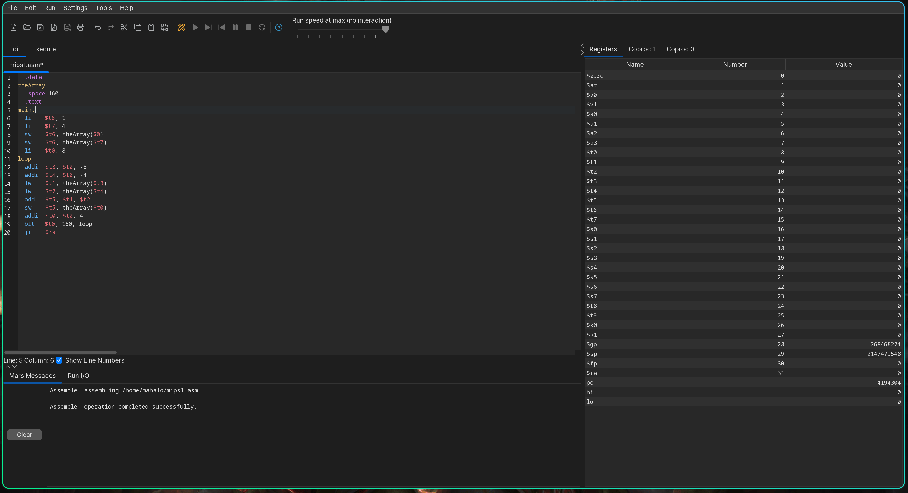

# MARS

> This is a fork of [The original MARS MIPS Assembler](https://github.com/dpetersanderson/MARS)

MARS (official) MIPS Assembler and Runtime Simulator

MARS is a lightweight interactive development environment (IDE) for programming in MIPS assembly language, intended for educational-level use with Patterson and Hennessy's Computer Organization and Design.

This is the original MARS, developed by Pete Sanderson and Ken Vollmar. Developed while Pete was professor at Otterbein University and Ken was professor at Missouri State University. Both are now retired. This is a legacy application but is very stable and continues to be used by universities throughout the world as of 2024. The last release was MARS 4.5 in August 2014.

## Features

This fork includes [Flatlaf](https://www.formdev.com/flatlaf/) to allow for:

- Partial dark mode support
- Modern macOS-style light and dark themes
- Crisp SVG toolbar icons that follow the theme
- Inter and JetBrains Mono fonts
- Native window decorations
- High DPI displays
- Automatic theme detection using [jSystemThemeDetector](https://github.com/Dansoftowner/jSystemThemeDetector)

## Download

Java jar , Linux & windows
[Latest Release](https://github.com/AquilaIgnis/MARS/releases/latest)

## List of merged upstream PRs and fixed issues

> merges by [Souvlaki42](https://github.com/Souvlaki42/MARS)

- [dpetersanderson #10](https://github.com/dpetersanderson/MARS/pull/10)
- [dpetersanderson #4](https://github.com/dpetersanderson/MARS/pull/4)
- [dpetersanderson @11](https://github.com/dpetersanderson/MARS/issues/11)
- [dpetersanderson #24](https://github.com/dpetersanderson/MARS/pull/24)
- [dpetersanderson #26](https://github.com/dpetersanderson/MARS/pull/26)
- [dpetersanderson #27](https://github.com/dpetersanderson/MARS/pull/27)

## Screenshot

## How to use

Run the app with the `./gradlew run` command.

- [Syscalls](./docs/mars_syscall_reference.md)
- [macros](./docs/mars_macros_reference.md)

## Credits

Obviously, thanks to [Pete Sanderson](https://github.com/dpetersanderson) for making the original app. \
Thanks to [Flatlaf](https://www.formdev.com/flatlaf/) for the legacy Java theming and modern display features support. \
Thanks to [Souvlaki42](https://github.com/Souvlaki42/MARS) for the direct fork that merged the adobe fixes.

## License

This fork is also licensed under the original MIT License. Check [LICENSE](./LICENSE) for details.
